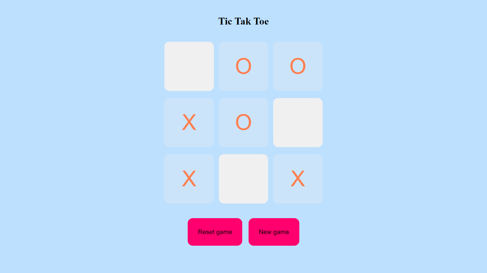

# Tic Tac Toe

Two-player Tic Tac Toe in HTML, CSS and JavaScript.

## Features

- Players take turns as X and O
- Detects all eight winning lines and draws
- Reset game and new game buttons

## Run it

No build step. Open `index.html` in a browser, or serve the folder with any static server, for example `python -m http.server`.

## Screenshots

